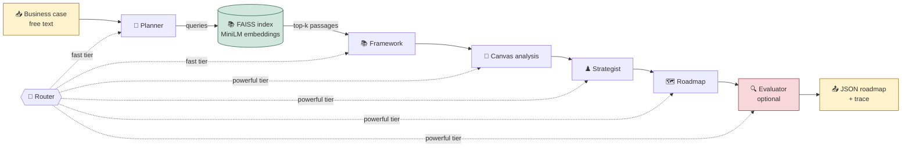
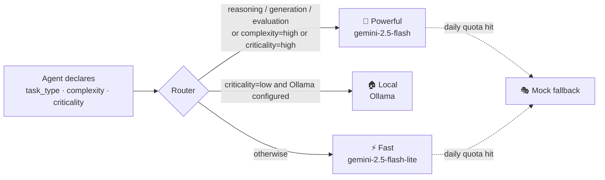
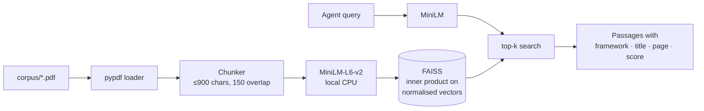

# 🧭 Digital Transformation Roadmap Generator

**Six LLM agents and a local RAG pipeline turn a free-text business case into a structured, framework-grounded digital transformation roadmap. Each task is routed to the cheapest model that can handle it.**

[](https://github.com/dhia-rek/multi-agent-multi-llm-rag/actions/workflows/ci.yml)
[](LICENSE)


<sub>Recorded in **demo mode**: retrieval is live, and the agent outputs come from a hand-written fixture (see [Demo mode](#-demo-mode-no-api-key)).</sub>

> **Live demo:** not deployed yet. The repo is ready for Hugging Face Spaces; see [Deploy](#%EF%B8%8F-deploy).

---

## What it does

You describe a company in plain text, e.g. *"a Swiss bike shop with 8 staff, a basic Shopify site, phone-only repair booking and a CHF 60k budget"*. The system:

1. **Plans**: extracts stakes, objectives and constraints, and writes retrieval queries.
2. **Retrieves**: searches a local FAISS index of three digital-transformation frameworks (Wade 2015, Peter's Digital Transformation Canvas, Elia et al. 2024).
3. **Reasons in stages**: four specialist agents classify the evidence, score maturity on the 7 Canvas action fields, build a strategy and produce a time-phased roadmap.
4. **Critiques**: an optional evaluator agent scores the roadmap against the frameworks.
5. **Routes**: each agent declares its task type, complexity and criticality, and a router sends it to a fast, powerful or local model.

The output is strict JSON (phases, initiatives, owners, KPIs, milestones, budget and framework anchors) plus a full trace showing which model ran each stage, why, and on which passages.

## Engineering highlights

- **Multi-agent orchestration**: six single-purpose agents with typed JSON contracts and a streaming orchestrator, so the UI renders each stage as it finishes.
- **Cost-aware multi-LLM routing**: an explicit policy (`src/routing/router.py`) maps each agent's task type, complexity and criticality to Gemini Flash-Lite, Gemini Flash or Ollama. Per-minute rate limits are retried with the server's suggested delay. If a tier hits its daily quota, it's swapped out so the run still completes.
- **Local RAG**: pypdf → paragraph-aware chunking → MiniLM embeddings on CPU → FAISS cosine index. No API cost for retrieval.
- **Measured, then fixed**: the evaluation harness showed that only 36% of corpus tokens were ever embedded, because whole PDF pages became single chunks. The [chunking fix](#-evaluation) raised that to 99% and more than doubled field-query precision.
- **Works without a key**: demo mode replays fixture agent outputs over live retrieval, so the app, API, CI and a public demo all run offline.
- **Production basics**: offline pytest suite, ruff, GitHub Actions, `uv.lock`, Dockerfile and Hugging Face Spaces config.
- **Optimisations**: persistent index, SHA-keyed pipeline cache, one shared prompt header, context capped at 6k chars per agent, and an optional evaluator.

---

## 🏗️ Architecture



| Agent | Framework anchor | Job | Tier |
|---|---|---|---|
| 🧭 Planner | Wade 2015 | Extract stakes and objectives, write retrieval queries | fast |
| 📚 Framework | all three | Classify passages by Why/What/How and the 7 action fields | fast |
| 🧮 Canvas analysis | Peter (Canvas) | Score maturity 1–5 per action field, list gaps | powerful |
| ♟️ Strategist | Elia et al. 2024 | Purpose, operational pillars, value, risks, quick wins | powerful |
| 🗺️ Roadmap | Peter (roadmap) | Phases, initiatives, owners, KPIs, milestones, budget | powerful |
| 🔍 Evaluator | all three | Critique, coverage check, score 1–10 | powerful |

<details>
<summary><b>Routing policy</b></summary>



Each agent sets three class attributes (`src/agents/*.py`); `Router.decide()` turns them into a tier and a human-readable reason that the UI shows.

</details>

<details>
<summary><b>RAG pipeline</b></summary>



</details>

---

## 📊 Evaluation

`python -m scripts.evaluate` runs offline over 5 SME business cases (`data/eval/cases.jsonl`).

**Chunking fix, before and after** (same corpus, same embedder):

| Metric | Before | After |
|---|---|---|
| Chunks | 52 | 205 |
| Corpus tokens inside the embedder's 256-token window | 36% | **99%** |
| Field-query precision@3 (7 Canvas fields; share of top-3 passages that discuss the field) | 0.19 | **0.48** |
| Median retrieval latency (CPU) | 17 ms | 20 ms |

pypdf output rarely contains blank lines, so the chunker treated each page as one paragraph. Chunks reached several thousand characters, and MiniLM silently truncated them, so most of each page was invisible to retrieval.

**Per-case retrieval** (top-6, query = business case text):

| Case | Framework papers in top-6 (of 3) | Share of passages from the example roadmap |
|---|---|---|
| alexandra_bikeshop | 0 | 1.00 |
| family_bakery | 2 | 0.50 |
| regional_logistics | 2 | 0.33 |
| dental_clinic_group | 2 | 0.50 |
| industrial_parts_distributor | 1 | 0.83 |

The worked bikeshop roadmap (`corpus/bikeshop_roadmap/`) is indexed alongside the framework papers and dominates retrieval, especially for the bikeshop case itself. See [Limitations](#%EF%B8%8F-limitations).

**Live pipeline metrics** (`python -m scripts.evaluate --live`, needs `GOOGLE_API_KEY`):

| Metric | Value |
|---|---|
| Agents returning valid JSON | TODO: run with a Gemini key |
| Canvas priority fields matching expected fields | TODO |
| Evaluator score (1–10), mean over 5 cases | TODO |
| End-to-end latency per case | TODO |

---

## 🚀 Quick start

Requires Python 3.10+ and [uv](https://docs.astral.sh/uv/).

```bash
git clone https://github.com/dhia-rek/multi-agent-multi-llm-rag && cd multi-agent-multi-llm-rag
uv sync                                   # installs pinned deps (CPU-only torch on Linux)
uv run python -m scripts.build_index      # one-off: PDFs → FAISS index (~30 s on CPU)
uv run streamlit run app/streamlit_app.py # → http://localhost:8501
```

That's enough to use the app: with no key it starts in **demo mode**. For live models, get a free Gemini key at <https://aistudio.google.com/app/apikey>, then:

```bash
cp .env.example .env    # set GOOGLE_API_KEY=...
```

<details>
<summary>Using pip instead of uv</summary>

```bash
python -m venv .venv && source .venv/bin/activate
pip install -r requirements.txt   # pinned export of uv.lock
python -m scripts.build_index
streamlit run app/streamlit_app.py
```

</details>

### REST API

```bash
uv run uvicorn api.main:app --port 8000   # Swagger UI at http://localhost:8000/docs
```

| Method | Path | Purpose |
|---|---|---|
| GET | `/health` | Liveness, configured models, index ready, `demo_mode` |
| GET | `/pipeline-info` | Models per tier, embedding model, chunking, top-k |
| POST | `/analyze` | Planner → RAG → Framework → Canvas only |
| POST | `/generate-roadmap` | Full pipeline: roadmap, optional evaluation, trace |

```bash
curl -s -X POST localhost:8000/generate-roadmap -H 'Content-Type: application/json' \
  -d '{"business_case": "Family bakery, 12 staff, wants online pre-orders and a loyalty app.", "run_evaluator": false}'
```

### 🎭 Demo mode (no API key)

| `DEMO_MODE` | Behaviour |
|---|---|
| `auto` (default) | Demo mode when `GOOGLE_API_KEY` is empty |
| `on` | Always demo mode, even with a key |
| `off` | Never: without a key, agents return placeholder mock text |

In demo mode, retrieval runs for real, while the six agents answer from [`data/demo/alexandra_bikeshop.fixture.json`](data/demo/alexandra_bikeshop.fixture.json). **That fixture is hand-written to match the agent schemas for the sample bikeshop case. It is not a recorded Gemini output.** Any other business case will still show bikeshop outputs, and the UI says so. Demo traces are cached separately from live ones.

### Configuration

| Variable | Default | |
|---|---|---|
| `GOOGLE_API_KEY` | – | Enables Gemini |
| `GEMINI_FAST_MODEL` | `gemini-2.5-flash-lite` | Fast tier |
| `GEMINI_POWERFUL_MODEL` | `gemini-2.5-flash` | Powerful tier |
| `OLLAMA_MODEL` / `OLLAMA_HOST` | – / `http://localhost:11434` | Optional local tier |
| `EMBEDDING_MODEL` | `sentence-transformers/all-MiniLM-L6-v2` | Local embedder |
| `CHUNK_SIZE` / `CHUNK_OVERLAP` / `RAG_TOP_K` | `900` / `150` / `6` | Retrieval |
| `DEMO_MODE` | `auto` | See above |

---

## 🖼️ Screenshots

| Home: architecture overview | RAG inspector |
|---|---|
|  |  |
| **Live pipeline run** | **Generated roadmap** |
|  |  |

The dashboard also has a **Multi-LLM Routing** page with a live policy tester, a **Frameworks** reference and a **How It Works** glossary.

---

## 🧪 Tests and CI

```bash
uv run pytest -q        # offline: fake embedder, demo client, no network or keys
uv run ruff check .
```

GitHub Actions runs two jobs on every push and PR: **lint + unit tests**, and a **smoke test** that builds the real index, runs the evaluation and calls the API in demo mode.

## ☁️ Deploy

`Dockerfile` + `deploy/start.sh` produce a CPU image that builds the index on first boot and serves Streamlit on port 7860. That's the layout Hugging Face Spaces (Docker SDK) expects. Step-by-step instructions and the secrets table are in [`deploy/huggingface/DEPLOY.md`](deploy/huggingface/DEPLOY.md).

```bash
docker build -t dt-roadmap . && docker run -p 7860:7860 -e GOOGLE_API_KEY=... dt-roadmap
```

---

## 📁 Project layout

```
app/                    Streamlit dashboard: home + 5 pages, teaching copy in edu_content.py
api/main.py             FastAPI service
src/
  agents/               6 agents, shared base (routing call, lenient JSON parsing), prompts.py
  orchestrator/         7-stage pipeline: run() and run_streaming(), disk-cached
  routing/router.py     tier policy + quota failover
  llm_clients/          gemini (google-genai) · ollama · demo (fixture) · mock
  data_ingestion/       pypdf loader
  chunking_embeddings/  chunker + sentence-transformers embedder
  vector_store/         FAISS build / save / load / search
  retrieval/            top-k retriever with framework filter
  cache/                SHA-keyed disk cache
scripts/                build_index.py · evaluate.py
data/                   sample case · demo fixture · eval cases
corpus/                 reference PDFs (third-party, see corpus/README.md)
tests/                  pytest suite
deploy/                 container entrypoint + Hugging Face Space card
```

## 🧰 Stack

Python · Google Gemini 2.5 (`google-genai`) · Ollama (optional) · sentence-transformers (MiniLM-L6-v2) · FAISS · pypdf · Streamlit · FastAPI · pydantic · tenacity · uv · pytest · ruff · GitHub Actions · Docker

## ⚠️ Limitations

- **Example roadmap in the index.** The worked bikeshop roadmap is indexed with the framework papers and supplies 63% of retrieved passages on average (100% for the bikeshop case). That's useful as an exemplar, but it also means the sample case partly retrieves its own answer.
- **Demo outputs are illustrative.** The fixture is hand-written; live-model numbers in the evaluation table are still TODO.
- **Lexical evaluation.** Field-query precision checks whether a passage names the field. It's a cheap proxy, not human relevance judgement.
- **English PDFs only, small corpus** (4 documents, 205 chunks).

---

## 👥 Team and project context

Built by **Dhia** ([@dhia-rek](https://github.com/dhia-rek)) and **Roy** ([@royhayek](https://github.com/royhayek)) as their M2 project for *Multi-LLM Architectures & Eco-Responsible AI* (ECE Paris, MSc AI, 2025–26). The brief: an AI system that turns a business case into a digital transformation roadmap, with RAG over provided frameworks, specialised agents, multi-LLM routing, cost optimisations, a dashboard and a REST API.

Dhia and Roy designed and built the system together during the course. After the course, a showcase pass (October 2026) added the offline demo mode, evaluation harness, chunking fix, Gemini SDK migration, tests, CI, packaging and deployment setup.

## 📄 License

Code: [MIT](LICENSE). The PDFs in `corpus/` are third-party publications included for academic use; their copyright stays with their authors (see [`corpus/README.md`](corpus/README.md)).
