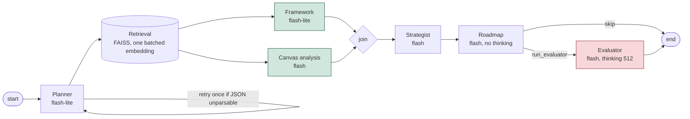
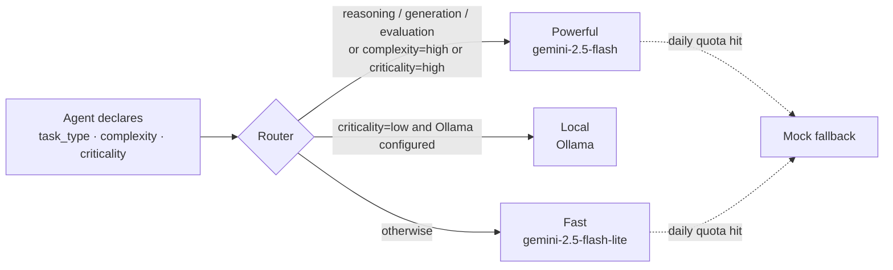
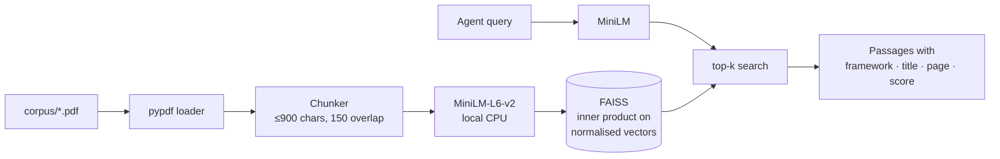

# Architecture

The pipeline is a [LangGraph](https://langchain-ai.github.io/langgraph/) `StateGraph` (`src/orchestrator/graph.py`) with a typed state, one node per agent, and Gemini behind `langchain-google-genai`. The router still decides flash-lite vs flash; offline and mock modes plug in as LangChain chat models too.

## Data dependencies

What each prompt actually consumes:

| Stage | Needs | Can run with |
|---|---|---|
| Planner | business case | – |
| Retrieval | planner's queries | – |
| Framework | planner summary + passages | **Canvas** |
| Canvas | planner summary/objectives/constraints + passages | **Framework** |
| Strategist | plan + canvas + framework | – |
| Roadmap | strategy + canvas | – |
| Evaluator | case + plan + strategy + roadmap | – |

The pipeline is almost entirely sequential. Only **Framework ‖ Canvas** can overlap, and only because the canvas prompt no longer receives the framework agent's output (it used to; the passages it also gets already carry the same evidence). Everything from the strategist on is a strict chain. The other speedups are therefore not parallelism:

- one batched embedding call for all planner queries instead of one per query
- compact JSON between agents (about 2–6% smaller prompts, `python -m scripts.bench_prompts`)
- per-agent thinking budgets: roadmap 0 (it only reshapes a finished strategy into JSON), evaluator 512, others at `GEMINI_THINKING_BUDGET`
- conditional edges: unparsable JSON from a live model re-runs that agent once; quota exhaustion fails over to a mock; missing planner queries fall back to the case text

| Agent | Framework anchor | Job | Tier |
|---|---|---|---|
|  Planner | Wade 2015 | Extract stakes and objectives, write retrieval queries | fast |
|  Framework | all three | Classify passages by Why/What/How and the 7 action fields | fast |
|  Canvas analysis | Peter (Canvas) | Score maturity 1–5 per action field, list gaps | powerful |
|  Strategist | Elia et al. 2024 | Purpose, operational pillars, value, risks, quick wins | powerful |
|  Roadmap | Peter (roadmap) | Phases, initiatives, owners, KPIs, milestones, budget | powerful |
|  Evaluator | all three | Critique, coverage check, score 1–10 | powerful |

## Routing policy

Each agent sets three class attributes (`src/agents/*.py`); `Router.decide()` turns them into a tier and a human-readable reason that the UI shows.

## RAG pipeline

## Old vs new orchestration

Same bikeshop case, `gemini-2.5-flash-lite` (planner, framework) and `gemini-2.5-flash` (the rest).

| | Old (sequential, main) | New (LangGraph) | How measured |
|---|---|---|---|
| Stages on the critical path | 7 | 6 (framework ‖ canvas) | graph structure, tested |
| Retrieval, 4 queries (median of 15, CPU) | 29.9 ms | 11.1 ms | measured, batched embedding |
| Strategist / roadmap / evaluator prompt size | 8356 / 7224 / 9980 chars | 7859 / 6845 / 9798 chars (−6% / −5% / −2%) | measured, `scripts.bench_prompts` |
| Canvas prompt | 2095 prompt tokens | smaller (no framework insights) | old: recorded run; new: not measured live |
| Thinking tokens, roadmap + evaluator | 756 + 776 | ≤ 0 + 512 (caps) | budgets set in code; actual use not measured live |
| End-to-end wall clock | **47.6 s** (recorded live run, 2026-10-10: 2.0+1.9+2.1+9.4+7.1+15.1+10.0) | **≈ 43 s, projection** | framework's 2.1 s hides behind canvas; roadmap without thinking is the likely bigger win |
| Total tokens | 10 632 prompt + 6 710 output + 3 159 thinking | not measured | – |

**Caveat:** a live new-vs-old Gemini comparison could not be completed. The free-tier daily cap (20 requests per model per day) on `gemini-2.5-flash` and then `flash-lite` was reached by the first benchmark runs, so later runs fell back to the mock and say nothing about speed. The old figures come from the recorded live run in the replay fixture; the new end-to-end figure is a projection from those stage timings, not a measurement. Rerun when quota resets: `python -m scripts.bench_live old` on `main` and `python -m scripts.bench_live new` on this branch (about 6 calls each).
